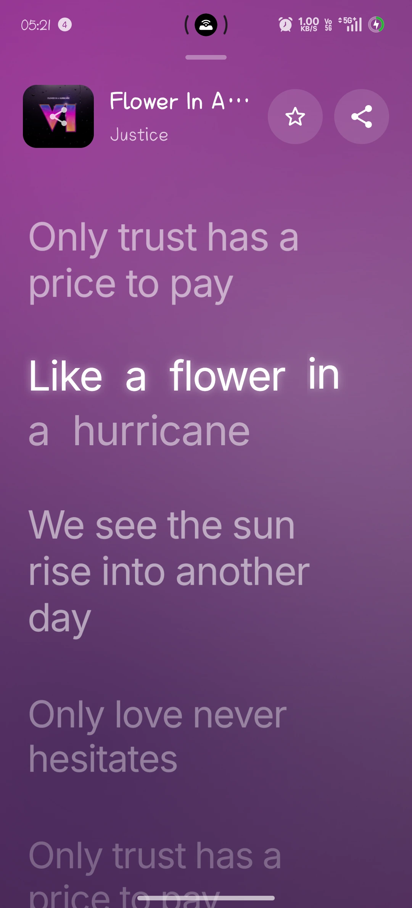
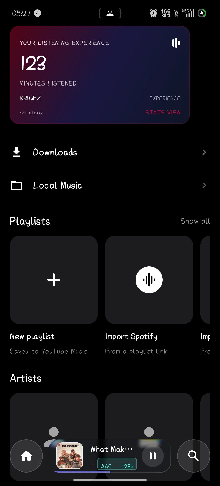

# Node Player

Node Player is a local-first, bit-perfect 32-bit floating-point audio player and hybrid YouTube Music client built with Compose Multiplatform for Android and Windows Desktop. Engineered with custom 120 Hz hardware-accelerated AGSL liquid glass shaders, it combines audiophile sound reproduction with fluid iOS-inspired spring physics and deep real-time personalization.

<p align="left">
  
</p>

[Live Website & Docs](https://krighz.github.io/node-player/) • [Features](https://krighz.github.io/node-player/features.html) • [Technical Docs](https://krighz.github.io/node-player/docs.html) • [Changelog](https://krighz.github.io/node-player/changelog.html) • [Releases](https://github.com/Krighz/node-player/releases) • [Discussions](https://github.com/Krighz/node-player/discussions)

---

### ✨ Highlights

* **Hybrid YouTube Music + 32-Bit Local Audio:** Seamlessly stream online with ~1.1s startup and 128 KB chunked caching, or decode bit-perfect local FLAC, ALAC, WAV, and MP3 via a pure 32-bit float audio engine (WASAPI Exclusive on Windows, direct audio sinks on Android).
* **5-Provider Word-by-Word Karaoke & Lyric Cards:** Sub-pixel 120 FPS syllable sweep powered by BiniLyrics, BetterLyrics, LyricsPlus, LrcLib, and KuGou; create and export shareable 4:3 & 1080×1920 Lyric Cards in one tap.
* **Smart Offline Mixtape:** Autonomous background Wi-Fi caching (60% discovery + 40% heavy rotation) with intelligent two-tier LRU eviction and zero-latency offline playback interception.
* **Full Interactive Artist Pages:** Immersive 380dp hero portraits, Shuffle/Play/Follow controls, Latest Release spotlight, 4-row Top Songs, and categorized discography shelves with "Show all" sub-sheets.
* **10-Band EQ + AutoEQ + DJ Blend Crossfade:** Studio-grade biquad equalizer with built-in Harman IEM/headphone target profiles and normalized acoustic-power DJ Blend gapless transitions.
* **Node Connect P2P Mesh (Windows ↔ Android):** Zero-config local Wi-Fi 16-bit 48kHz PCM casting, stateful playback handoff, and encrypted mTLS QR pairing between PC and phone.

---

### 📱 Live Interface

| Home & Discovery | Word-by-Word Karaoke | Full Artist Page |
| :---: | :---: | :---: |
|  |  |  |

*Additional captures:* [Now Playing](docs/screenshots/02_now_playing.webp) • [Shareable Lyric Card](docs/screenshots/04_lyric_card.webp) • [10-Band Parametric EQ & DSP](docs/screenshots/06_mixtape_and_dsp.webp)

---

### 🛠️ Building From Source

Requires JDK 17 and Android SDK 34:

```bash
# Compile and package Android APK
./gradlew :app-android:assembleRelease

# Run Windows Desktop application
./gradlew :app-desktop:run

# Package Windows MSI / EXE installer
./gradlew :app-desktop:packageMsi
```

---

### 📄 License & Support

* **License:** Licensed under the [Apache License 2.0](LICENSE). Third-party acknowledgments and attributions are detailed in [THIRD_PARTY_LICENSES.md](THIRD_PARTY_LICENSES.md).
* **Voluntary UPI Support:** If you love Node Player, support development via UPI: `7063061981@fam` (Payee: **Krighz**).
