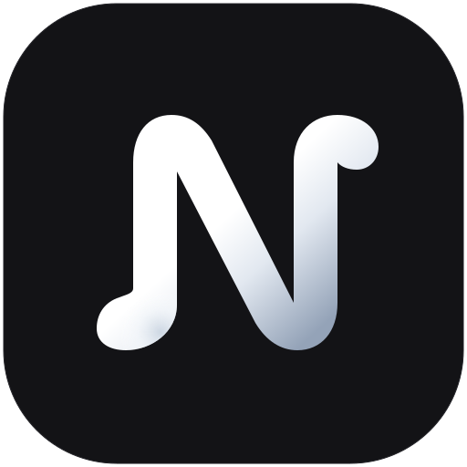
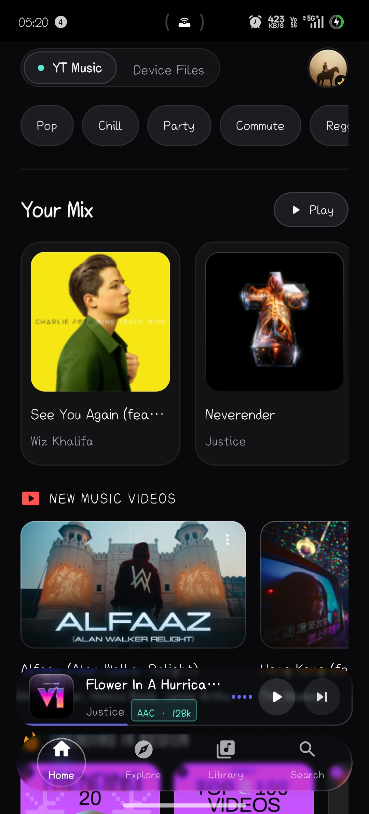
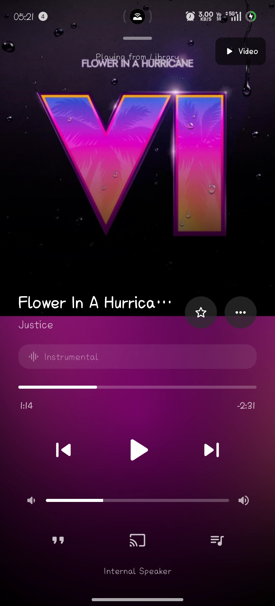

# Node Player

> [!IMPORTANT]
> **Node Player is merging with [Auralis](https://github.com/voidXatrix-zudz/Auralis)!**  
> We are officially joining forces with the Auralis team to build the ultimate open-source music player, uniting Node Player's 32-bit audiophile DSP, AGSL liquid glass shaders, and synced lyrics with Auralis. Explore the repository: [github.com/voidXatrix-zudz/Auralis](https://github.com/voidXatrix-zudz/Auralis).

Node Player is a local-first, bit-perfect 32-bit floating-point audio player and hybrid YouTube Music client built with Compose Multiplatform for Android and Windows Desktop. Engineered with custom 120 Hz hardware-accelerated AGSL liquid glass shaders, it combines audiophile sound reproduction with fluid iOS-inspired spring physics and deep real-time personalization.

<p align="left">
  
</p>

[Website & Docs](https://krighz.github.io/node-player/) • [Download v2.2.0](https://github.com/Krighz/node-player/releases/tag/v2.2.0) • [Features](https://krighz.github.io/node-player/features.html) • [Docs](https://krighz.github.io/node-player/docs.html) • [Changelog](CHANGELOG.md) • [Discussions](https://github.com/Krighz/node-player/discussions)

---

### ✨ What's New in v2.2.0 (Auralis Merger Edition)

* **Major Milestone - Merging with Auralis:** Joining forces with [Auralis](https://github.com/voidXatrix-zudz/Auralis) to unite our audiophile DSP engine and liquid glass design into one next-generation player.
* **Interactive 3D Gyroscope Artwork Parallax:** Sensor-driven 3D pitch and roll tilt for hero album art with dynamic liquid glass specular reflections (opt-in in Settings).
* **Full-Player Tactile Haptics:** Subtle micro-vibrations across track taps, queue additions, scrubbing, and dock tab navigation.
* **Synchronized Lyric Card Fonts:** Exported Lyric Cards now dynamically render with the exact font selected in Full-Screen Lyrics settings.
* **Fluid Spring Physics & Glitch Fixes:** Fixed NowPlaying double-dismiss swipe glitch, eliminated scroll recomposition jitter, and added spring popping card-to-screen transitions.

---

### ✨ What's New in v2.0.0

* **Universal Curved 'N' Brand Identity:** Finalized squircle brand mark and monochrome adaptive icons across Android, Windows Desktop, Compose vectors, and web.
* **5-Provider Word-by-Word Karaoke & Lyric Cards:** Sub-pixel 120 FPS syllable sweep (BiniLyrics, BetterLyrics, LyricsPlus, LrcLib, KuGou) + instant 1080×1920 & 4:3 ambient Lyric Card exports.
* **Smart Offline Mixtape:** Autonomous background Wi-Fi caching (60% discovery + 40% heavy rotation) with intelligent two-tier LRU eviction and zero-latency offline playback interception.
* **Full Interactive Artist Pages:** Immersive 380dp hero portraits, Shuffle/Play/Follow controls, Latest Release spotlight, 4-row Top Songs, and categorized discography shelves with "Show all" sub-sheets.
* **32-Bit Float DSP, AutoEQ & DJ Blend:** 10-band parametric EQ, built-in Harman IEM/headphone target profiles, and normalized acoustic-power DJ Blend gapless transitions.
* **Node Connect P2P Mesh (Windows ↔ Android):** Zero-config local Wi-Fi 16-bit 48kHz PCM casting, stateful playback handoff, and encrypted mTLS QR pairing between PC and phone.

---

### 📱 Live Interface

| Home & Discovery | Now Playing & Karaoke | Full Artist Page |
| :---: | :---: | :---: |
|  |  |  |

*Additional captures:* [Word-by-Word Karaoke](docs/screenshots/03_karaoke_lyrics.webp) • [Shareable Lyric Card](docs/screenshots/04_lyric_card.webp) • [10-Band Parametric EQ & DSP](docs/screenshots/06_mixtape_and_dsp.webp)

---

### 🛠️ Building From Source

Requires JDK 17 and Android SDK 34:

```bash
# Compile and package Android APK
./gradlew :app-android:assembleRelease

# Run Windows Desktop application
./gradlew :app-desktop:run

# Package Windows MSI / EXE installer
./gradlew :app-desktop:packageMsi
```

---

### 📄 License & Support

* **License:** Licensed under the [Apache License 2.0](LICENSE). Third-party acknowledgments and attributions are detailed in [THIRD_PARTY_LICENSES.md](THIRD_PARTY_LICENSES.md).
* **Voluntary UPI Support:** If you love Node Player, support development via UPI: `7063061981@fam` (Payee: **Krighz**).
