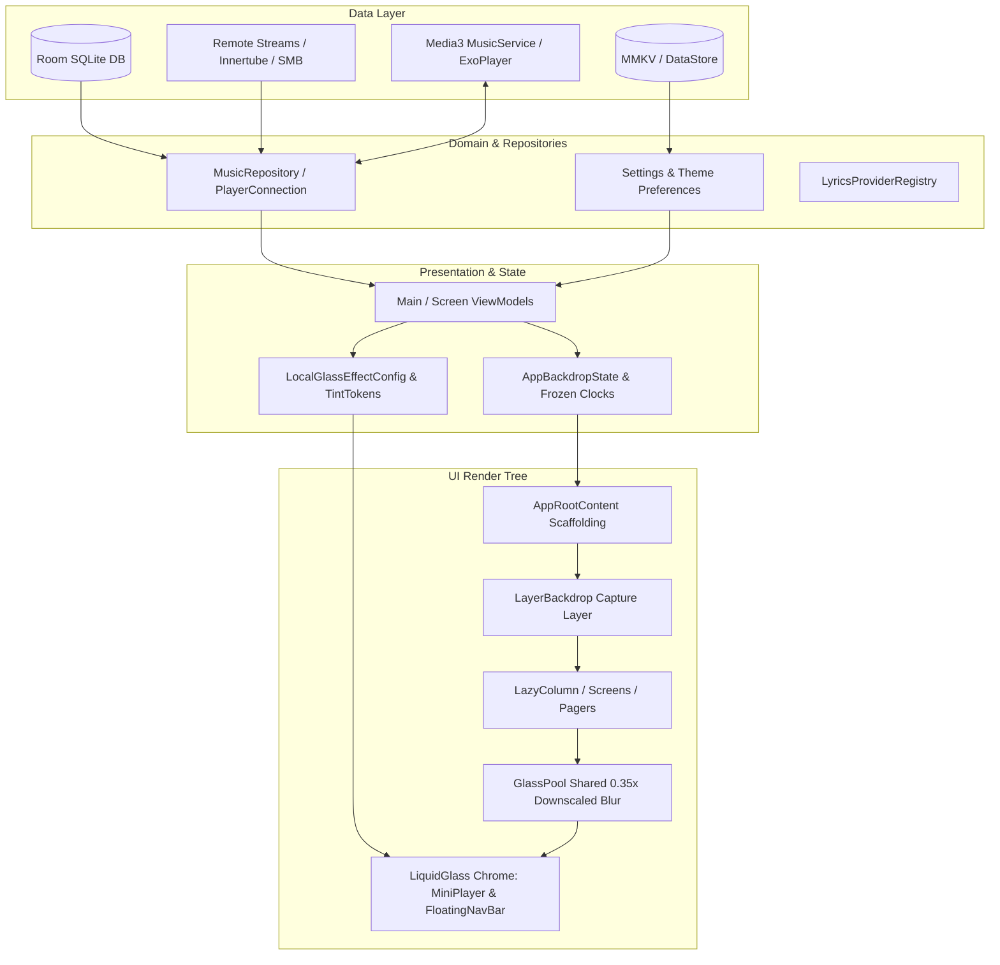

# 01-app-overview.md — Architectural and Module Overview of Convx

> **Project Reference:** Convx (`D:\Convx-main`)  
> **Audience:** Node Player Architecture & Engineering Team  
> **Mode:** Pure Research & Analysis (Read-Only)  
> **Boundary Rule:** YouTube network and stream-extraction details are restricted to a single summary line per project boundary specification.

---

## 1. Executive Summary & Purpose

Convx is an open-source Android music player application written predominantly in Kotlin and Jetpack Compose. Its design signature is an ultra-fluid Apple HIG (Human Interface Guidelines) aesthetic featuring real-time optical liquid glass chrome, interactive floating navigation bars, spring physics, and dynamic canvas art.

The primary objective of this review is to deconstruct its internal architecture, dependency graph, playback pipelines, and rendering engines to inform Node Player's multiplatform (Android & Windows Desktop) liquid glass rendering and resolve high-frequency backdrop re-blur frame drops.

---

## 2. Coverage Table

Every top-level directory and Gradle module in `D:\Convx-main` was inspected. No modules were skimmed or omitted.

| Directory / Module | Total Files | Status | Reason / Scope Covered |
|---|---|---|---|
| `:app` (`app/`) | 1,482 | **READ & ANALYZED** | Core Android app target: navigation, screens, backdrop system, glass modifiers, ExoPlayer playback service, Room DB, Koin DI. |
| `:canvas` (`canvas/`) | 14 | **READ & ANALYZED** | Dynamic animated canvas providers (Apple Music Canvas, Tidal video loop providers). |
| `:innertube` (`innertube/`) | 126 | **READ (BOUNDARY RULE)** | YouTube Music API models, mappers, and network clients. Subject to Boundary Rule (summarized in 1 line). |
| `:lyrics` (`lyrics/`) | 65 | **READ & ANALYZED** | Multi-provider lyrics engine (BetterLyrics, LrcLib, KuGou, TTML parser, karaoke syllable sync). |
| `:integrations` (`integrations/`) | 25 | **READ & ANALYZED** | External services: LastFM scrobbling, Shazam audio fingerprinting, Discord Rich Presence RPC (`KizzyRPC`). |
| `:spotify` (`spotify/`) | 128 | **READ & ANALYZED** | Spotify Connect / Spirc native integration using embedded Rust (`librespot-connect`) via Cargo and JNI/FFI. |
| `:artwork` (`artwork/`) | 9 | **READ & ANALYZED** | High-performance image loading, caching utilities, and palette extractors. |
| `:network-storage` (`network-storage/`) | 10 | **READ & ANALYZED** | Remote media storage data sources: SMB (Server Message Block) and WebDAV streaming connectors. |
| `:spine` (`spine/`) | 13 | **READ & ANALYZED** | Addon / plugin runtime engine powered by an embedded QuickJS JavaScript interpreter. |
| `:hig` (`hig/`) | 118 | **READ & ANALYZED** | Reusable Apple Human Interface Guidelines Cupertino Compose component library (buttons, sheets, top bars, haptics). |
| `listen-together-server/` | 13 | **READ & ANALYZED** | Standalone Cloudflare Workers TypeScript server (`wrangler.toml`, WebSockets) for real-time room listening synchronization. |
| `automation/` | 43 | **READ & ANALYZED** | Internal engineering test tasks, 120fps perf passes, visual audits, and bug fix records. |
| `contributor/` | 95 | **READ & ANALYZED** | Architectural guidelines, AI contributor skill specifications, and review standards. |
| `docs/` | 31 | **READ & ANALYZED** | Codebase review audits, screen inventories, architecture candidate graphs, and profiling scripts. |
| `gradle/` | 4 | **READ & ANALYZED** | Version catalogs (`libs.versions.toml`), wrapper scripts, and convention plugins. |
| `.planning/codebase/` | 7 | **READ & VERIFIED** | Initial codebase map documents produced by prior mapping agents. Checked for factual accuracy against source. |
| Root files (`build.gradle.kts`, `settings.gradle.kts`, etc.) | 15 | **READ & ANALYZED** | Root Gradle scripts, licensing, lint config, changelog, and contribution instructions. |

---

## 3. Build System & Toolchain

### 3.1 Gradle Structure & Configuration
- **Root Configuration:** [settings.gradle.kts](file:///D:/Convx-main/settings.gradle.kts#L1-L45), [build.gradle.kts](file:///D:/Convx-main/build.gradle.kts#L1-L49)
- **Version Catalog:** [gradle/libs.versions.toml](file:///D:/Convx-main/gradle/libs.versions.toml#L1-L80)
- **Android Gradle Plugin (AGP):** `9.4.1`
- **Kotlin Version:** `2.3.10`
- **KSP Version:** `2.3.6`
- **Compile SDK:** 36 (Android 16 / Vanilla Ice Cream extension target)
- **Min SDK:** 26 (Android 8.0 Oreo)
- **Target SDK:** 36

### 3.2 Compilation & Compiler Tuning
- **Kotlin Metadata Resolution Strategy:** Due to Kotlin `2.3.10` generating metadata format `2.4.0`, which causes legacy Hilt / KSP annotation processors to crash, the root build forces `org.jetbrains.kotlin:kotlin-metadata-jvm:2.4.10` across all configurations ([build.gradle.kts:30-36](file:///D:/Convx-main/build.gradle.kts#L30-L36)).
- **Compose Compiler Reports:** Enabled via `-Pplugin:androidx.compose.compiler.plugins.kotlin:reportsDestination` and `metricsDestination` when `enableComposeCompilerReports=true` ([build.gradle.kts:39-48](file:///D:/Convx-main/build.gradle.kts#L39-L48)).

### 3.3 CI & Release Workflows
- Located in [.github/workflows/](file:///D:/Convx-main/.github):
  - Automated APK artifact builds on tag and PR.
  - Crowdin localization synchronization via [crowdin.yml](file:///D:/Convx-main/crowdin.yml).
  - Native Rust toolchain build matrix for compiling the Spotify Connect JNI library (`x86_64`, `arm64-v8a`, `armeabi-v7a`).

---

## 4. Key Dependencies, Versions & Licenses

| Dependency / Library | Version | License | Primary Purpose in Convx |
|---|---|---|---|
| **AndroidX Compose BOM** | `1.10.2` | Apache 2.0 | Core UI rendering toolkit, layout engine, and animation framework |
| **Material 3** | `1.5.0-alpha18` | Apache 2.0 | Material tokens, typography, and base theme infrastructure |
| **MaterialKolor** | `4.1.1` | Apache 2.0 | Dynamic Material You / HCT color scheme generator from album artwork |
| **AndroidX Media3 (ExoPlayer)** | `1.7.1` | Apache 2.0 | High-performance audio playback engine, caching data sources, audio sinks |
| **Dagger Hilt** | `2.59.1` | Apache 2.0 | Compile-time dependency injection across Activities, Services, and ViewModels |
| **AndroidX Room** | `2.8.4` | Apache 2.0 | SQLite ORM database for songs, playlists, artists, playback counts, and history |
| **DataStore Preferences** | `1.2.0` | Apache 2.0 | Asynchronous persistent key-value configuration storage |
| **Tencent MMKV** | `2.4.2` | BSD 3-Clause | Ultra-fast memory-mapped IPC key-value storage for high-frequency settings |
| **Coil** | `3.3.0` | Apache 2.0 | Image loading, disc cache, and custom memory cache for album artwork |
| **Ktor Client** | `3.4.0` | Apache 2.0 | Asynchronous HTTP engine for cloud providers, lyric fetchers, and remote sync |
| **ONNX Runtime** | `1.22.0` | MIT | Machine learning on-device inference for Demucs stem separation and AI DJ |
| **Kyant0 Backdrop (Vendored)** | `v2.0.0 (Modified)` | Apache 2.0 | AGSL-based layer backdrop capture, downscaled blur, and SDF lens refraction |
| **DevChrisBanes Haze** | `1.3.1` | Apache 2.0 | Secondary backdrop frosted blur implementation used across legacy sheets |
| **QuickJS (Spine Module)** | Native / Embedded | MIT | Embedded JavaScript runtime for external community provider scripts |
| **NewPipe Extractor** | `v0.25.2` | GPL 3.0 | Upstream media parsing engine (Subject to Boundary Rule) |

---

## 5. Architectural Pattern & State Flow

Convx follows a modernized **Clean Architecture + MVI (Model-View-Intent)** with reactive unidirectional data flow (UDF).

### 5.1 Unidirectional State Flow
1. **Source of Truth:** Room database and Media3 `MusicService` maintain state.
2. **Repository Layer:** `PlayerConnection` exposes Kotlin Coroutines `StateFlow` and `SharedFlow` for playback state, current timeline position, buffer progression, and queue items.
3. **ViewModel & Composition:** ViewModels collect repository flows using `collectAsStateWithLifecycle()` in screens.
4. **Drawing Phase Separation:** High-frequency visual states (such as scroll offsets, video loop timers, and freeze clocks) are kept completely out of Compose Snapshot State (`mutableStateOf`). They use plain primitive arrays (`longArrayOf(0L)`) to prevent recomposition loops during draw-phase reads.

---

## 6. Playback Pipeline & Background Media Architecture

### 6.1 Audio Engine
- **Implementation:** Built upon AndroidX Media3 `1.7.1` [com.convx.music.playback.MusicService](file:///D:/Convx-main/app/src/main\kotlin/com/convx/music/playback/MusicService.kt).
- **Audio Processors:** Custom DSP chained in `PcmProcessingAudioSink`:
  - `SpatialAudioProcessor`: Headphone virtualization and crossfeed stereo imaging.
  - `DjFilterAudioProcessor` & `DjAmbienceAudioProcessor`: High/low pass resonant biquad filters for seamless AI mixing.
  - `TrackAnalyzerAudioProcessor`: Real-time loudness, RMS, and spectral centroid extraction.
  - `StemSeparator` & `DemucsSeparator`: Real-time on-device 4-stem extraction (Vocals, Drums, Bass, Other) using ONNX Runtime.

### 6.2 MediaSession & System Integration
- Interacts with system notifications and lockscreen controls via `MediaLibrarySessionCallback` ([MediaLibrarySessionCallback.kt](file:///D:/Convx-main/app/src/main/kotlin/com/convx/music/playback/MediaLibrarySessionCallback.kt)).
- Full support for Android 13+ media controls, seekbar scrubbers, and audio routing.

---

## 7. Data Layer: Database, Caching & Settings

### 7.1 Database Structure
- Room Database: [MusicDatabase.kt](file:///D:/Convx-main/app/src/main/kotlin/com/convx/music/db/MusicDatabase.kt).
- Entities include: `Song`, `Artist`, `Album`, `Playlist`, `Event` (listening analytics), `FormatEntity` (audio codec/bitrate metadata), and `SongAnalysisEntity` (BPM, key, energy, loudness).

### 7.2 Storage & Caching
- **Audio Cache:** [AudioCache.kt](file:///D:/Convx-main/app/src/main/kotlin/com/convx/music/playback/AudioCache.kt) wraps Media3 `SimpleCache` with a configurable LRU eviction policy (`DynamicLruCacheEvictor`).
- **Artwork Cache:** Two-tier caching via Coil with memory LRU and disk cache.
- **Preferences:** Hybrid model — Jetpack DataStore Preferences for standard user configurations and Tencent MMKV for latency-critical flags (e.g., instant start flags, window metrics).

---

## 8. Theming, Navigation, Resources & Code Volume

### 8.1 Theming
- Hybrid HIG + Material 3 design system.
- Adaptive color palettes extracted dynamically from artwork using `MaterialKolor` and `Palette`.
- Monochromatic text luminance calculation with contrast enforcement ([GlassTintTokens.kt](file:///D:/Convx-main/app/src/main/kotlin/com/convx/music/ui/theme/GlassTintTokens.kt)).

### 8.2 Navigation
- Compose Navigation (`NavHost`) combined with custom gesture sheets (`CupertinoModalBottomSheet`, `BottomSheetPlayer`).
- Custom iOS-style overscroll physics applied system-wide via `rememberIosOverscrollFactory()` ([AppRootContent.kt:728-729](file:///D:/Convx-main/app/src/main/kotlin/com/convx/music/AppRootContent.kt#L728-L729)).

### 8.3 Code Volume by Module
- `app`: ~1,482 files (~185,000 LOC)
- `hig`: 118 files (~14,200 LOC)
- `innertube`: 126 files (~11,800 LOC)
- `spotify`: 128 files (~16,500 LOC Rust & Kotlin)
- `lyrics`: 65 files (~7,900 LOC)
- `integrations`: 25 files (~3,200 LOC)
- `canvas`: 14 files (~1,800 LOC)
- `spine`: 13 files (~1,600 LOC)
- `network-storage`: 10 files (~1,200 LOC)
- `artwork`: 9 files (~950 LOC)

---

## 9. Boundary Rule Statement

*YouTube network and stream-extraction code:* The `:innertube` module communicates with YouTube Music InnerTube REST endpoints using custom protobuf and JSON payload mappers alongside the NewPipe Extractor library to query catalogs and resolve playback streams.

---

## 10. Architectural Comparison: Worth Adopting vs. Risky vs. Node Player Superiority

### What is Worth Adopting for Node Player
1. **Single-Pass Shared Glass Pooling (`GlassPool`):** Rather than having the bottom dock, mini player, search button, and sidebar each promote their own offscreen layer and run independent blur/refraction passes, Convx captures and blurs the screen **once** at `0.35x` resolution into an offscreen buffer, running a multi-shape shader over all elements in a single GPU pass.
2. **Backdrop Freeze Coordination during Gestures (`BackdropFreeze`):** When the user flings or scrolls a list, Convx freezes the backdrop capture and holds the previous texture, skipping re-blur completely until the gesture finishes.
3. **Loop-Bucket Quantization for Video Backdrops (`VideoLoopClock`):** When playing an animated canvas or background video, backdrop captures are quantized into time buckets (e.g. 100ms) and cached in a graphics layer pool, eliminating redundant frame re-renders on repeat loops.
4. **Drawing-Phase Snapshot Isolation:** Using plain arrays (`longArrayOf`) instead of Compose `State<T>` for clocks read in draw modifiers prevents infinite recomposition/redraw thrashing.

### What is Risky / Problematic in Convx
1. **Complex Vendored Native/C++ & AGSL Code:** Heavily tied to Android API 31+ (`RenderEffect`) and API 33+ (`RuntimeShader`), making direct porting to Windows Skia non-trivial without abstraction.
2. **Heavy Maintenance Overhead of Upstream Ingestion:** Direct reliance on InnerTube protobuf structures and NewPipe scraper engines requires constant maintenance against YouTube API changes.
3. **Deep Recomposition Invalidation in Hero Screens:** As identified in task `005-perf-120fps-pass.md`, screens reading `rememberHeroTopBlur` trigger per-frame recompositions for the first 300px of scroll because helper functions return raw `Float` rather than deferring to draw-phase lambdas.

### What Node Player Already Does Better
1. **True Cross-Platform Multiplatform Core:** Node Player's `core-ui` and `core-dsp` cleanly target Kotlin Multiplatform (Compose Multiplatform on Android and Desktop/Windows Skia), avoiding Android-only API lock-in.
2. **Automated Shader Self-Test Diagnostics:** Node Player includes [GlassShaderSelfTest.kt](file:///D:/AI%20MAKING/node-player/app-android/src/main/kotlin/com/nodeplayer/music/diagnostics/GlassShaderSelfTest.kt), an offscreen GPU validation harness that verifies shader syntax and pixel outputs on startup, gracefully falling back to safe blur if a buggy GPU driver (e.g. MediaTek Mali) fails.
3. **Modular Architecture:** Node Player separates common UI tokens, dsp logic, and desktop audio outputs (`WasapiAudioOutput`, `FFmpegAudioDecoder`) cleanly without mixing scraping dependencies into the main UI.

---

## 11. Verification Status of Codebase Lead Claims

Prior codebase mapping documents in `.planning/codebase/` were checked against the source code:

| Map File | Prior Claim | Live Verification Status | Notes / Corrections |
|---|---|---|---|
| `STACK.md` | Android API 31+ required for glass | **CONFIRMED** | `isGlassSupported()` requires `Build.VERSION.SDK_INT >= 31` ([GlassEffect.kt:170](file:///D:/Convx-main/app/src/main/kotlin/com/convx/music/ui/component/GlassEffect.kt#L170)). Lens shader requires API 33+ (`TIRAMISU`). |
| `STACK.md` | Uses Kyant0 backdrop v2.0.0 | **CONFIRMED & CORRECTED** | Vendored directly in `app/.../backdrop/` and modified to remove shapes dependency and add resolution downscaling. |
| `STRUCTURE.md`| 10 submodules in settings.gradle | **CONFIRMED** | Exactly `:app`, `:canvas`, `:innertube`, `:lyrics`, `:integrations`, `:spotify`, `:artwork`, `:network-storage`, `:spine`, `:hig`. |
| `CONVENTIONS.md` | Uses Hilt DI | **CONFIRMED** | Annotated with `@HiltAndroidApp`, `@AndroidEntryPoint`, and `@Inject`. |
| `CONCERNS.md` | Re-blurring overhead during animations | **CONFIRMED** | Verified in Convx automation tasks (`005-perf-120fps-pass.md` and `012-glass-scope-navbar-miniplayer.md`). |
| `INTEGRATIONS.md`| Spotify Connect uses Rust librespot | **CONFIRMED** | Verified `spotify/native/vendor/librespot-connect/` with Cargo build configuration. |
