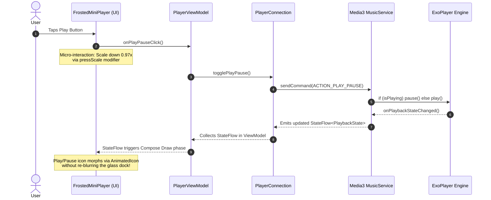

# 05-explained.md — Educational Guide: How Convx Works from the Ground Up

> **Project Reference:** Convx (`D:\Convx-main`)  
> **Audience:** Engineers Learning Modern Android, Jetpack Compose & High-End Optical Shaders  
> **Mode:** Teaching & Deconstruction

---

## 1. Glossary of Terms & Core Concepts

When studying the Convx codebase, you will encounter several concepts from modern graphics and Jetpack Compose:

- **Jetpack Compose:** Android's modern declarative UI toolkit. You describe your UI using Kotlin functions annotated with `@Composable` rather than inflating XML layouts.
- **Recomposition:** When application state changes, Compose re-executes the composable functions that read that state to update the display tree.
- **Compose Phases (Composition $\to$ Layout $\to$ Draw):**
  1. *Composition:* Decides *what* UI to show.
  2. *Layout:* Measures and places elements on the screen.
  3. *Draw:* Executes GPU draw commands (canvas, textures, shaders).
  *Key Rule:* If an animated value (like a scroll offset or wave time) is read during the **Draw** phase, Composition and Layout are completely skipped, delivering smooth 120Hz performance.
- **AGSL (Android Graphics Shading Language):** Android 13's shading language, syntactically nearly identical to GLSL (OpenGL) and SkSL (Skia). It executes small pixel shaders on the GPU for custom visual effects.
- **RenderEffect:** Android 12's HWUI pipeline API that applies visual post-processing (Gaussian blur, color matrix adjustments, or custom AGSL shaders) directly to an Android `RenderNode`.
- **SDF (Signed Distance Field):** A mathematical function that outputs the shortest distance from a given pixel coordinate to the boundary of a shape. A negative distance means the pixel is inside the shape; a positive distance means it is outside.
- **GraphicsLayer / RenderNode:** A GPU hardware display list that records drawing commands into an offscreen texture, allowing transforms, alpha fading, and shader effects without redrawing children from scratch.
- **ExoPlayer / Media3:** Google’s enterprise-grade media playback engine for Android, managing audio streams, codec negotiation, buffers, and system audio focus.
- **Koin / Dagger Hilt:** Dependency injection frameworks that automatically instantiate and supply dependencies (databases, network engines, view models) to classes across the app.

---

## 2. How to Read This Codebase: Recommended Reading Order

If you are opening the Convx repository for the first time, do not start with random screens. Follow this logical progression:

```
1. gradle/libs.versions.toml ──> Understand dependencies and versions
2. app/build.gradle.kts      ──> See module plugins, build types, and flags
3. settings.gradle.kts       ──> Inspect all 10 submodules
4. AppRootContent.kt         ──> The master scaffold providing themes, backdrops, and navigation
5. GlassTintTokens.kt        ──> The design tokens for glass surfaces
6. GlassEffect.kt            ──> The core liquidGlass modifier
7. backdrop/GlassPool.kt     ──> The shared downscaled blur and multi-shape manager
8. backdrop/internal/Shaders ──> The AGSL shader source code
9. Player.kt / MiniPlayer.kt ──> Real UI consumers of the glass system
```

---

## 3. The Life of One Tap: From Screen to Data and Back

To understand how user actions flow through the app, let us trace what happens when a user taps the **Play/Pause** button on the floating mini-player:



---

## 4. How the UI is Built: From Smallest Component Up

Convx constructs its interface hierarchically, using composability to combine small primitives into intricate screens:

1. **Tokens (`AppleTokens.kt`):** Pure numbers and colors (`AppleTokens.CardCorner = 20.dp`, `AppleTokens.AccentRed`).
2. **Shapes & Outlines:** Continuous curvature squircles (`ContinuousRoundedRectangle`) providing curvature without corner pinching.
3. **Modifiers (`Modifier.liquidGlass`):** Adds the backdrop capture, 0.35x blur, SDF lens refraction, specular white highlight, and outer dark boundary rim.
4. **Primitives:** `GlassCircleButton`, `GlassSwitch`, `CupertinoSearchTextField`.
5. **Compounds:** `FrostedMiniPlayer` (artwork thumbnail + marquee title + progress bar + playback controls).
6. **Scaffolding (`AppRootContent.kt`):** Combines the screen content, the floating glass dock, the bottom sheet player, and the shared `GlassPool`.

---

## 5. Practical Exercises for Node Player Developers

To build confidence with these concepts before touching the production codebase, try these three exercises:

### Exercise 1: Build a Pure AGSL SDF Lens in Android Studio
- **Goal:** Create a simple Compose app that renders a box with an AGSL `RuntimeShader`.
- **Task:** Implement the `sdRoundedRect` and `circleMap` equations from `03-glass-shader.md`. Verify that pixels within 20px of the border displace inward to create a lens distortion.

### Exercise 2: Implement a Downscaled Offscreen GraphicsLayer
- **Goal:** Avoid full-resolution blurring.
- **Task:** Take a high-resolution `Image`, record it into a `GraphicsLayer` at `0.35f` scale, apply a blur `RenderEffect`, and render it back scaled up (`scale(1f / 0.35f)`). Observe how GPU memory and frame render times improve on a mid-range phone.

### Exercise 3: Build a Scroll-Freezing NestedScrollConnection
- **Goal:** Eliminate jank during scroll flings.
- **Task:** Attach a `NestedScrollConnection` to a `LazyColumn`. On `onPreScroll`, set a boolean flag `isScrolling = true`. On `onPostFling`, set `isScrolling = false`. During drawing, bypass shader updates while `isScrolling` is true.

---

## 6. Open Check: What Needs Further Clarification?

If any part of this architecture remains unclear, consider these follow-up areas:
1. Would you like a deeper breakdown of the mathematical derivation behind the circular arc mapping function?
2. Should we explore how Skia's `RuntimeEffect` on Windows handles uniforms compared to Android's AGSL `RuntimeShader`?
3. Would you like to review how the ONNX machine learning stem separator interacts with ExoPlayer's audio sink?
