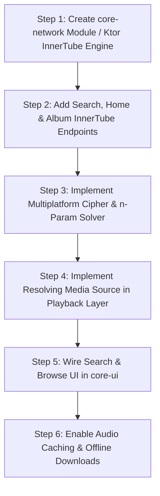

# 07-innertube-and-youtube-playback.md — InnerTube Architecture & Stream Resolution

> **Project Reference:** Convx (`D:\Convx-main`)  
> **Target Project:** Node Player (`D:\AI MAKING\node-player`)  
> **Audience:** Core Playback & Network Engineering  
> **Scope:** Complete deconstruction of YouTube Music InnerTube communication, stream URL resolution, cipher deobfuscation, PoToken generation, and ExoPlayer integration.

---

## 1. What is InnerTube and How Does Convx Use It?

**InnerTube** is Google's internal API engine that powers YouTube, YouTube Music, and YouTube TV across all client platforms (Web, Android, iOS, Apple TV, VisionOS, and Smart TVs). Unlike public Google Data APIs (which require heavy quota management and API keys), InnerTube uses context-based endpoints that authenticate client instances and exchange JSON or Protobuf payloads.

In Convx:
- **Module:** `:innertube` (`D:\Convx-main\innertube`)
- **Key Facade:** `com.music.innertube.YouTube` (implementing `InnertubeRepository`) backed by `InnerTube.kt` engine.
- **Network Engine:** Built with **Ktor Client 3.4.0** wrapped over **OkHttp 3** engine with HTTP/2 and Gzip/Deflate content compression ([InnerTube.kt:80-147](file:///D:/Convx-main/innertube/src/main/kotlin/com/music/innertube/InnerTube.kt#L80-L147)).

---

## 2. InnerTube API Architecture in Convx

```mermaid
flowchart TD
    subgraph UI & Playback Request
        Screen[Search / Home / Playlist UI]
        MusicService[MusicService / ExoPlayer]
    end

    subgraph Repository Layer
        YTFacade[YouTube.kt Facade]
        ITRepo[InnerTube.kt Network Engine]
    end

    subgraph Stream Resolvers
        YTPlayerUtils[YTPlayerUtils.kt]
        PoGen[PoTokenGenerator (WebView)]
        Cipher[CipherDeobfuscator (WebView)]
        NParam[EjsNTransformSolver]
        NewPipe[NewPipeExtractor Fallback]
    end

    subgraph Media3 Pipeline
        ResolvingSource[ResolvingMediaSource]
        CacheSource[CacheDataSource / AudioCache]
        Exo[ExoPlayer Engine]
    end

    Screen -->|Fetch browse, album, search| YTFacade
    YTFacade --> ITRepo
    ITRepo -->|Ktor HTTP/2 POST with client headers| GoogleYT[YouTube Music /youtubei/v1/]

    MusicService -->|Queue Track ID| ResolvingSource
    ResolvingSource -->|On prepare| YTPlayerUtils
    YTPlayerUtils -->|1. Try ANDROID_VR client| ITRepo
    YTPlayerUtils -->|If ciphered url| Cipher
    YTPlayerUtils -->|If n-param throttled| NParam
    YTPlayerUtils -->|If bot-guarded| PoGen
    YTPlayerUtils -->|If streams fail| NewPipe

    YTPlayerUtils -->|Direct Playable Audio Stream URL| ResolvingSource
    ResolvingSource --> CacheSource
    CacheSource --> Exo
```

### 2.1 The Context System & Client Impersonation
InnerTube endpoints require an impersonation `Context` JSON header describing the client make, model, locale, and version:
- Base URL: `https://music.youtube.com/youtubei/v1/`
- Every request sets:
  - `X-Goog-Api-Format-Version: 1`
  - `X-YouTube-Client-Name: <clientId>`
  - `X-YouTube-Client-Version: <clientVersion>`
  - `X-Origin: https://music.youtube.com`
  - `Referer: https://music.youtube.com/`
  - `X-Goog-Visitor-Id: <visitorData>` (Maintained for session continuity)

### 2.2 Client Matrix in Convx
Convx defines several distinct clients in [YouTubeClient.kt](file:///D:/Convx-main/innertube/src/main/kotlin/com/music/innertube/models/YouTubeClient.kt) and rotates them strategically:

1. **`ANDROID_VR_1_43_32` (Primary Streaming Client):**  
   - *Why Convx uses it first:* The Meta Quest / Android VR YouTube client has a high rate of unthrottled direct audio streams, does **not** enforce Google's Proof of Origin (`poToken`) bot verification, and starts with near-zero latency ([YTPlayerUtils.kt:280-286](file:///D:/Convx-main/app/src/main/kotlin/com/convx/music/utils/YTPlayerUtils.kt#L280-L286)).
2. **`WEB_REMIX` (Authenticated Metadata Client):**  
   - Used when fetching user playlists, liked songs, listen history, and audio config (such as volume normalization / replay gain).
3. **`IOS` & `VISIONOS` (Anti-Bot Fallbacks):**  
   - When tracks trigger Google bot-detection (HTTP 403 Forbidden), Convx falls back to `VISIONOS` and `IOS` clients which consistently pass rate-limit checks ([YTPlayerUtils.kt:298-319](file:///D:/Convx-main/app/src/main/kotlin/com/convx/music/utils/YTPlayerUtils.kt#L298-L319)).
4. **`TVHTML5_SIMPLY_EMBEDDED_PLAYER`:**  
   - Used for age-restricted content or embedded video items.

---

## 3. How YouTube Music Streams Are Resolved & Played

Resolving an audio stream from YouTube is multi-stage because Google uses signature ciphers, `n`-parameter throttling, and bot verification.

### 3.1 Lazy Stream Resolution via `ResolvingMediaSource`
Instead of pre-fetching streaming URLs for every track in a 500-song playlist (which would expire after 6 hours and exhaust network bandwidth), Convx uses a custom Media3 `ResolvingMediaSource` ([ResolvingMediaSource.kt:26-66](file:///D:/Convx-main/app/src/main/kotlin/com/convx/music/playback/ResolvingMediaSource.kt#L26-L66)):
1. ExoPlayer is loaded with lightweight `MediaItem`s containing only metadata and the 11-character `videoId` (`mediaId`).
2. When ExoPlayer transitions to `STATE_BUFFERING` for the upcoming track, `ResolvingMediaSource.prepareSourceInternal()` invokes `YTPlayerUtils.playerResponseForPlayback(videoId)`.
3. The real stream URL is resolved asynchronously on `Dispatchers.IO` and injected into a child `ProgressiveMediaSource` or `HlsMediaSource`.

### 3.2 Cipher Deobfuscation (`CipherDeobfuscator.kt`)
When a streaming format contains `signatureCipher` instead of a direct `url`:
- The obfuscated signature string `s`, parameter key `sp`, and `baseUrl` are extracted.
- Convx executes an offscreen headless Android `WebView` that loads YouTube's active `player.js` script.
- The JavaScript function corresponding to that build decrypts `s` into a valid signature, which is appended as `&$sp=$sig` ([CipherDeobfuscator.kt:39-62](file:///D:/Convx-main/app/src/main/kotlin/com/convx/music/utils/cipher/CipherDeobfuscator.kt#L39-L62)).

### 3.3 The `n`-Parameter Throttling Solver (`EjsNTransformSolver.kt`)
YouTube throttles download speeds on unapproved players by altering the `?n=...` URL parameter:
- If unhandled, audio buffers stall after 10–20 seconds.
- Convx parses `n`, feeds it into an embedded JavaScript solver (`transformNParamInUrl`), and replaces `n` with the transformed token, restoring full network throughput.

### 3.4 Proof of Origin Token (`PoTokenGenerator.kt`)
For Web/Android clients where Google enforces Botguard / Play Integrity:
- Convx runs `PoTokenGenerator` using an offscreen `PoTokenWebView` ([PoTokenGenerator.kt:12-75](file:///D:/Convx-main/app/src/main/kotlin/com/convx/music/utils/potoken/PoTokenGenerator.kt#L12-L75)).
- It acquires a session Proof of Origin token (`poToken`) and Visitor Data, ensuring stream requests are recognized as legitimate browser/app interactions.

### 3.5 Fallback to NewPipe Extractor
If all InnerTube client endpoints fail or return HTTP 403:
- Convx initializes `NewPipeExtractor` ([NewPipe.kt:142-188](file:///D:/Convx-main/innertube/src/main/kotlin/com/music/innertube/pages/NewPipe.kt#L142-L188)).
- It invokes `StreamInfo.getInfo(NewPipe.getService(0), "https://www.youtube.com/watch?v=$videoId")` to parse web HTML and extract working audio/video stream candidates.

---

## 4. How to Implement YouTube Music in Node Player

To bring online YouTube Music streaming into Node Player without disrupting its clean Kotlin Multiplatform architecture:

### 4.1 Architecture Strategy for Node Player
Node Player is multiplatform (Android + Windows Desktop). A pure Android `WebView` cipher solver cannot run on Windows Desktop.

**The Solution:**
1. **Shared Network Layer in `core-network`:**
   - Implement the InnerTube Ktor HTTP client and mappers (`HomePage`, `SearchPage`, `ArtistPage`, `WatchEndpoint`) in Kotlin Multiplatform `commonMain`.
   - Use Ktor Client with OkHttp engine on Android and CIO/WinHttp on Desktop.
2. **Multiplatform JS Cipher Solver:**
   - On Android: Headless `WebView` or embedded QuickJS.
   - On Windows: Embedded QuickJS (like Convx's `:spine` module) or JVM JavaScript engine to execute YouTube's `player.js` cipher deciphering and `n`-parameter transformation on both platforms identically!
3. **MediaSource Integration:**
   - In `app-android`: Use `ResolvingMediaSource` wrapping Media3 `ProgressiveMediaSource` with `SimpleCache`.
   - In `app-desktop`: Use Node Player's `FFmpegAudioDecoder` / `WindowsPlaybackEngine` to open the resolved HTTP audio URL directly with a streaming buffer.

---

## 5. Step-by-Step Implementation Roadmap for Node Player



### Step 1: Core Network Engine (`core-network`)
- Port `YouTubeClient.kt` and `InnerTube.kt` to KMP using Ktor Client.
- Set `ANDROID_VR` as primary client to minimize cipher/poToken hurdles initially.

### Step 2: Stream Resolution (`core-network`)
- Implement `resolveStream(videoId: String): Result<String>`.
- Extract highest-bitrate Opus (`audio/webm; codecs="opus"`, itag 251, ~160kbps) or AAC (`audio/mp4; codecs="mp4a.40.2"`, itag 140, ~128kbps).

### Step 3: Player Layer Hookup
- **Android:** In `PlaybackService.kt`, attach `ResolvingMediaSource` to ExoPlayer.
- **Desktop:** In `WindowsPlaybackEngine.kt`, pass the resolved stream URL directly to FFmpeg decoder.

### Step 4: UI Integration in `core-ui`
- Add an "Online Search" tab to `SearchCapsule.kt`.
- Display YouTube search results alongside local tracks using standard `GlassCard` item layouts.
