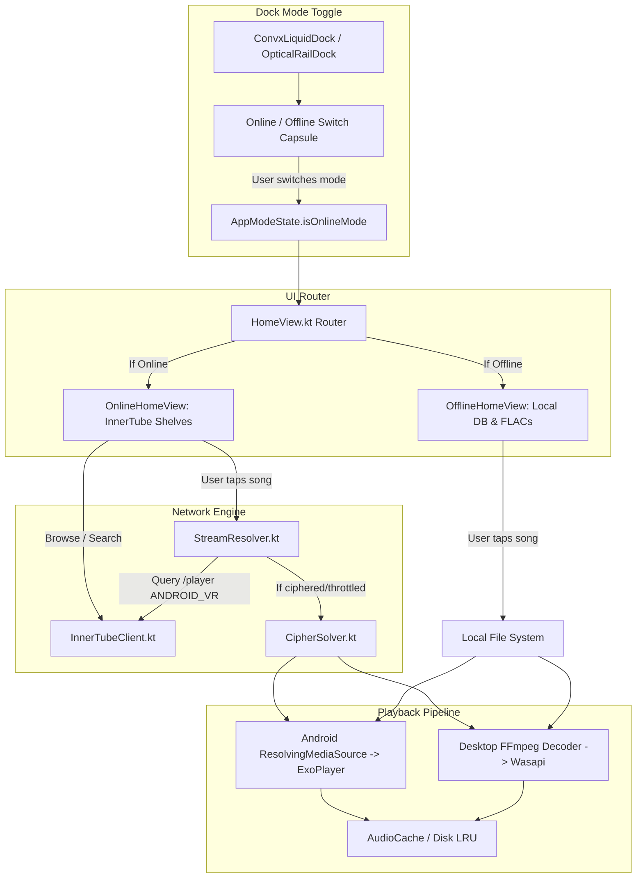

# PROMPT: Implement YouTube InnerTube Music Streaming with Online/Offline Dock Switcher in Node Player

> **Instructions for the AI Assistant / Engineer:**
> You are tasked with implementing the full YouTube Music integration into **Node Player** (`D:\Node player\node-player`). This includes querying YouTube Music via the InnerTube API, parsing metadata, resolving high-bitrate audio streams (Opus 160k / AAC 128k), decrypting signature ciphers, defeating `n`-parameter throttling, and wiring lazy streaming into the playback engines on both Android (ExoPlayer via `ResolvingMediaSource`) and Windows Desktop (`FFmpegAudioDecoder` / `WindowsPlaybackEngine`).
>
> **NEW CORE REQUIREMENT — DOCK MODE SWITCHER (Online vs. Offline):**
> You must create an **Online / Offline Mode Toggle** directly integrated into the main navigation dock (both mobile `ConvxLiquidDock` and desktop `OpticalRailDock`).
> - **Online Mode ON:** Clicking **Home** opens the **Online Feed** with YouTube Music recommendations, trending tracks, mood mixes, and automatically plays music from YouTube Music.
> - **Online Mode OFF (Default):** Falls back completely to **Offline Mode**, where clicking Home opens local library tracks, device-scanned albums, and cached offline music with zero network requests.
>
> Follow every directory path, rule, function specification, data contract, and error-handling policy described below.

---

## 1. Directory Tree & Target File Locations

Every module and file in **Node Player** (`D:\Node player\node-player`) has a dedicated role. Do not create files outside these designated paths:

```
D:\Node player\node-player\
├── core-common\
│   └── src\commonMain\kotlin\com\nodeplayer\common\
│       └── AppModeState.kt                           <-- NEW: App-wide Online/Offline mode state flow
│
├── core-model\
│   └── src\commonMain\kotlin\com\nodeplayer\model\
│       ├── Track.kt                                  <-- Update: nodeplayer://youtube/{id} & stream metadata
│       └── AudioAndThemeConfig.kt                    <-- AudioOutputInfo & dynamic codec/bitrate badges
│
├── core-network\
│   └── src\commonMain\kotlin\com\nodeplayer\network\
│       ├── innertube\
│       │   ├── InnerTubeClient.kt                    <-- NEW: Ktor HTTP/2 client for YouTube Music
│       │   ├── YouTubeModels.kt                      <-- NEW: Deserialization models (Search, Player, Next)
│       │   ├── StreamResolver.kt                     <-- NEW: Multi-client rotation (ANDROID_VR, IOS) & format selector
│       │   └── CipherSolver.kt                       <-- NEW: Cross-platform cipher & n-param decipher solver
│       └── service\
│           └── NodeConnectHub.kt                     <-- Retain existing wireless sync intact
│
├── core-ui\
│   └── src\commonMain\kotlin\com\nodeplayer\ui\
│       ├── components\
│       │   ├── ConvxLiquidDock.kt                    <-- UPDATE: Mobile dock with Online/Offline toggle capsule
│       │   ├── OpticalRailDock.kt                    <-- UPDATE: Desktop rail dock with Online/Offline toggle
│       │   ├── ConvxMiniPlayer.kt                    <-- Mini-player with dynamic OPUS / HI-RES badges
│       │   ├── SearchCapsule.kt                      <-- UPDATE: Online search tab & auto-complete
│       │   └── LiquidGlassBackground.kt              <-- 4-tier lag-free LiquidGlass background
│       └── screens\
│           ├── HomeView.kt                           <-- UPDATE: Renders OnlineHomeView or OfflineHomeView based on toggle
│           ├── OnlineHomeView.kt                     <-- NEW: YouTube Music curated flow, trending & radio shelves
│           └── OfflineHomeView.kt                    <-- NEW: Local offline mixes, recently played, device FLACs
│
├── app-android\
│   └── src\main\kotlin\com\nodeplayer\music\
│       ├── MainActivity.kt                           <-- Android navigation & mode observer
│       ├── service\
│       │   ├── PlaybackService.kt                    <-- Media3 service attaching ResolvingMediaSource
│       │   └── ResolvingMediaSource.kt               <-- NEW: Lazy Media3 ExoPlayer stream resolver
│       └── cipher\
│           └── AndroidCipherSolver.kt                <-- Android headless WebView script runner
│
└── app-desktop\
    └── src\main\kotlin\com\nodeplayer\desktop\
        ├── Main.kt                                   <-- Desktop root layout with vertical rail & mode switch
        ├── audio\
        │   ├── WindowsPlaybackEngine.kt              <-- UPDATE: Streams HTTPS URLs to FFmpeg decoder
        │   └── FFmpegAudioDecoder.kt                 <-- Streaming network buffer with auto-reconnect
        └── cipher\
            └── DesktopCipherSolver.kt                <-- Windows QuickJS / JVM script decipher runner
```

---

## 2. Non-Negotiable Engineering Rules & Constraints

1. **Permission to Leverage Convx InnerTube Client Directly:**
   - **EXPLICIT USER PERMISSION GRANTED:** You are authorized to directly copy, port, or adapt the complete InnerTube client, mappers, and models from the Convx directory at `D:\Node player\Others\Convx-main\innertube\` (or `D:\Convx-main\innertube\`) into Node Player's `core-network`.
   - You do NOT need to write the 126+ InnerTube endpoint files or JSON response mappers from scratch. Adapt Convx's battle-tested `:innertube` implementation directly into `core-network/src/commonMain/kotlin/com/nodeplayer/network/innertube/`, ensuring multiplatform compatibility.
   - Also leverage Convx's `YTPlayerUtils.kt`, `CipherDeobfuscator.kt`, `EjsNTransformSolver.kt`, and `PoTokenGenerator.kt` from `D:\Node player\Others\Convx-main\app\src\main\kotlin\com\convx\music\utils\` for cipher solving and stream URL extraction.

2. **Multiplatform Clean Architecture:**
   - All network clients, InnerTube endpoints, and parser models MUST live in `core-network` in Kotlin Multiplatform `commonMain`.
   - Never import `android.*` packages into `core-network` or `core-common`. Android-specific classes (Media3, Android WebView, Context) belong exclusively in `app-android`. Desktop-specific classes (WASAPI, Skia, Java Process) belong in `app-desktop`.
2. **Online / Offline Mode Isolation:**
   - `AppModeState.isOnlineMode` controls the active state.
   - When `isOnlineMode == false`: **Strictly zero background requests** to YouTube. The Home screen displays only local database tracks, downloaded songs, and local device folders.
   - When `isOnlineMode == true`: Home screen displays dynamic YouTube Music shelves (*Curated Flow*, *Trending*, *Mood Mixes*, *Artist Radio*), and searches query InnerTube.
3. **Lazy Stream Resolution (Anti-Bandwidth & Anti-Ban Rule):**
   - **Never** resolve stream playback URLs upfront when searching, browsing, or loading a playlist. Pre-resolving expires within 6 hours and causes IP rate-limiting.
   - Songs in queues must be lightweight `Track` models containing a synthetic URI: `nodeplayer://youtube/{videoId}`.
   - Stream URLs must be resolved **only** when the playback engine actively prepares the track.
4. **Primary Client Strategy (`ANDROID_VR`):**
   - Use the `ANDROID_VR_1_43_32` client headers as the primary InnerTube client for playback format requests.
   - *Rationale:* ANDROID_VR serves direct unthrottled audio streams without enforcing Google Proof of Origin (`poToken`) bot-guards and with minimal signature cipher enforcement.
   - If `ANDROID_VR` fails or returns HTTP 403, fall back to `IOS`, `VISIONOS`, and `WEB_REMIX` in sequence.
5. **Thread Safety & Dispatchers:**
   - All network calls, JSON deserialization, and cipher solving must run on `Dispatchers.IO`. Never block the main/UI thread.
6. **Disk Caching for Offline Playback:**
   - All resolved and streamed audio bytes must pass through Node Player's cache layer (`AudioCache` / `CacheDataSource` on Android; file cache on Desktop) so that replaying a streamed song plays offline with zero network usage.
7. **No Breaking Regressions:**
   - Existing local playback (FLAC, MP3, WAV, WASAPI Exclusive mode) and NodeConnect wireless sync must continue functioning without alterations.

---

## 3. Architecture & Data Flow



---

## 4. The Dock Mode Switcher: UI & State Implementation

### 4.1 State Owner: `AppModeState.kt` (`core-common`)
**File:** `core-common/src/commonMain/kotlin/com/nodeplayer/common/AppModeState.kt`

```kotlin
package com.nodeplayer.common

import kotlinx.coroutines.flow.MutableStateFlow
import kotlinx.coroutines.flow.StateFlow
import kotlinx.coroutines.flow.asStateFlow

object AppModeState {
    private val _isOnlineMode = MutableStateFlow(false) // Default is Offline Mode
    val isOnlineMode: StateFlow<Boolean> = _isOnlineMode.asStateFlow()

    fun setOnlineMode(enabled: Boolean) {
        _isOnlineMode.value = enabled
    }

    fun toggleMode() {
        _isOnlineMode.value = !_isOnlineMode.value
    }
}
```

### 4.2 Dock Integration: `ConvxLiquidDock.kt` (Mobile)
**File:** `core-ui/src/commonMain/kotlin/com/nodeplayer/ui/components/ConvxLiquidDock.kt`

- **Visual Location:** Situated directly beside the main navigation tabs or as an integrated mode pill in the dock header.
- **Styling:** An optical LiquidGlass pill (`height: 32.dp`) using `ContinuousCapsule` shape.
  - When **Offline:** Subtle dark glass background with a green leaf/disk icon and text `"Offline"`.
  - When **Online:** Vibrant glowing cyan/amber glass accent with a cloud/music icon and text `"Online"`.
- **Micro-Interaction:** Smooth animated sliding puck between `Offline` and `Online` states with haptic feedback on tap.

### 4.3 Desktop Rail Integration: `OpticalRailDock.kt` (Windows)
**File:** `core-ui/src/commonMain/kotlin/com/nodeplayer/ui/components/OpticalRailDock.kt`

- **Visual Location:** Positioned at the top or bottom of the left vertical navigation rail.
- **Styling:** A vertical optical switcher pill with two icons (Antenna/Cloud for Online, Disk/Folder for Offline). Clicking seamlessly updates `AppModeState.setOnlineMode(...)`.

### 4.4 Home Router: `HomeView.kt`
**File:** `core-ui/src/commonMain/kotlin/com/nodeplayer/ui/screens/HomeView.kt`

```kotlin
@Composable
fun HomeView(
    // ... parameters ...
) {
    val isOnline by AppModeState.isOnlineMode.collectAsState()

    AnimatedContent(
        targetState = isOnline,
        transitionSpec = { fadeIn(tween(260)) togetherWith fadeOut(tween(260)) },
        label = "HomeModeTransition"
    ) { online ->
        if (online) {
            OnlineHomeView(
                onPlayTrack = onPlayTrack,
                onOpenAlbum = onOpenAlbum,
                onOpenArtist = onOpenArtist
            )
        } else {
            OfflineHomeView(
                onPlayTrack = onPlayTrack,
                onOpenAlbum = onOpenAlbum,
                onOpenArtist = onOpenArtist
            )
        }
    }
}
```

---

## 5. InnerTube Client & Stream Resolution Specifications

### 5.1 `InnerTubeClient.kt` (`core-network`)
**File:** `core-network/src/commonMain/kotlin/com/nodeplayer/network/innertube/InnerTubeClient.kt`

#### Required Endpoints:
1. `suspend fun getHomeRecommendations(): Result<List<YouTubeSection>>`
   - **URL:** `POST https://music.youtube.com/youtubei/v1/browse`
   - **Payload:** `{"browseId": "FEmusic_home"}` with `ANDROID_VR` client context.
   - **Expected Output:** Returns curated shelves (*Quick Picks*, *Trending*, *Recommended Playlists*).
2. `suspend fun search(query: String, filter: SearchFilter = SearchFilter.SONGS): Result<List<YouTubeTrackItem>>`
   - **URL:** `POST https://music.youtube.com/youtubei/v1/search`
   - **Expected Output:** Track list with `videoId`, `title`, `artist`, `durationSeconds`, and high-res artwork URL.
3. `suspend fun getPlayerResponse(videoId: String, client: YouTubeClientProfile = YouTubeClientProfile.ANDROID_VR): Result<PlayerResponse>`
   - **URL:** `POST https://music.youtube.com/youtubei/v1/player`
   - **Expected Output:** Deserialized `PlayerResponse` containing `streamingData.adaptiveFormats` (itag 251 Opus / itag 140 AAC).
4. `suspend fun getNextRadio(videoId: String): Result<List<YouTubeTrackItem>>`
   - **URL:** `POST https://music.youtube.com/youtubei/v1/next`
   - **Expected Output:** Similar tracks for infinite autoplay queue.

### 5.2 `StreamResolver.kt` (`core-network`)
**File:** `core-network/src/commonMain/kotlin/com/nodeplayer/network/innertube/StreamResolver.kt`

- **Format Selection Logic:**
  1. Priority 1: `itag 251` (`audio/webm; codecs="opus"`, 160 kbps, 48 kHz).
  2. Priority 2: `itag 140` (`audio/mp4; codecs="mp4a.40.2"`, 128 kbps, 44.1 kHz).
- **Anti-Bot Client Rotation:**
  - Try `ANDROID_VR_1_43_32` first (fastest, no `poToken` requirement).
  - If HTTP 403 or empty streamingData: automatically fallback to `IOS` $\to$ `VISIONOS` $\to$ `WEB_REMIX`.
- **Anti-Throttling `n`-Transform & Signature Decryption:**
  - Check for `signatureCipher`: call `CipherSolver.decrypt(cipher, videoId)`.
  - Check for `?n=...`: call `CipherSolver.transformN(nToken)` to prevent 15-second download throttling.
- **Probe Verification:** Perform a lightweight HTTP `Range: bytes=0-1024` request to confirm the link returns HTTP 206 before handing to player.

---

## 6. Playback Engines Integration (Android & Windows)

### 6.1 Android: `ResolvingMediaSource.kt` (`app-android`)
**File:** `app-android/src/main/kotlin/com/nodeplayer/music/service/ResolvingMediaSource.kt`

- Custom Media3 `CompositeMediaSource<Unit>` attached to ExoPlayer in `PlaybackService.kt`.
- When ExoPlayer prepares a `MediaItem` whose URI begins with `nodeplayer://youtube/{id}`:
  1. `prepareSourceInternal()` is invoked by ExoPlayer.
  2. Launches a coroutine on `Dispatchers.IO` calling `StreamResolver.resolveStreamUrl(videoId)`.
  3. Binds the resolved HTTPS URL into a `ProgressiveMediaSource` wrapped in `CacheDataSource.Factory` (using Node Player's `AudioCache`).
  4. Calls `prepareChildSource(Unit, liveSource)`.

### 6.2 Windows Desktop: `WindowsPlaybackEngine.kt` (`app-desktop`)
**File:** `app-desktop/src/main/kotlin/com/nodeplayer/desktop/audio/WindowsPlaybackEngine.kt`

- In `playTrack(track)`:
  - If `track.path.startsWith("nodeplayer://youtube/")`:
    - Extract `videoId`.
    - Asynchronously resolve live HTTPS URL using `StreamResolver`.
    - Pass URL to `FFmpegAudioDecoder.openStream(streamUrl)`.
  - Configure FFmpeg AVFormat options:
    - `reconnect=1`
    - `reconnect_streamed=1`
    - `reconnect_delay_max=5`
  - Stream PCM samples directly into `WasapiAudioOutput` at 48,000 Hz.

---

## 7. Dynamic Quality Badges & Top Header Requirements

1. **Top Header Audio Output Selector:**
   - Must show the **actual physical output device** (e.g., `Speakers (Realtek(R) Audio)`, `Sennheiser HD 800 S`, `HDMI (NVIDIA High Definition Audio)`).
   - Must NOT show redundant `32-bit` or `24-bit` text in the device title.
2. **Dynamic Format & Codec Badge:**
   - **When playing YouTube Music:** Display `OPUS • 160k` or `AAC • 128k` (Cyan/Amber frosted badge).
   - **When playing local tracks:** Display `HI-RES` **only** if verified: sample rate $>48\text{ kHz}$ or bit depth $>16\text{-bit}$ (e.g. `FLAC • 24-bit / 96kHz`). Otherwise display standard format tags (`FLAC • 16-bit / 44.1kHz` or `MP3 • 320k`).
3. **Four Mobile Shortcuts Grid:**
   - Shortcut 1: **Offline Music** (Local & cached YouTube tracks).
   - Shortcut 2: **Device Connect** (Node Connect wireless sync & pairing).
   - Shortcut 3: **Hi-Res Collection** (Filtered list of verified 24-bit/FLAC tracks).
   - Shortcut 4: **My Playlists** (User-created playlists).
4. **Recently Played Shelf:**
   - Display album squircle thumbnails with high-contrast frosted badges showing exact play counts (`11x plays`, `8x plays`).

---

## 8. Definition of Done & Verification Checklist

- [ ] `AppModeState.kt` toggles between Online and Offline mode without crashing.
- [ ] In Offline mode: Home view opens local tracks and albums; zero network requests occur.
- [ ] In Online mode: Clicking Home displays YouTube Music recommendations and searches query InnerTube.
- [ ] Tapping a YouTube Music track resolves and starts playing audio within $<800\text{ ms}$.
- [ ] ExoPlayer on Android and FFmpeg on Windows Desktop play the Opus 160k stream seamlessly.
- [ ] Streamed tracks cache to disk and play offline when replayed.
- [ ] Top bar output selector displays the real physical device name.
- [ ] Format badge accurately reflects `OPUS 160k` for YouTube and verified `HI-RES` for local 24-bit tracks.
- [ ] No regressions in local playback, WASAPI exclusive mode, or wireless NodeConnect pairing.
